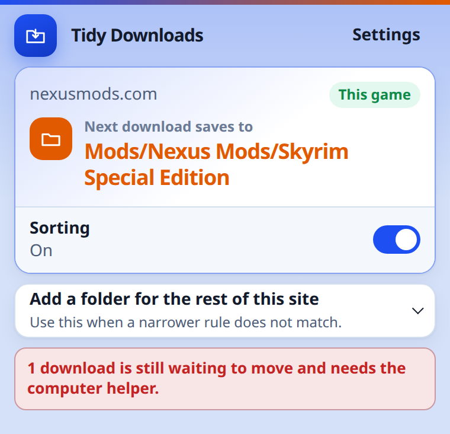
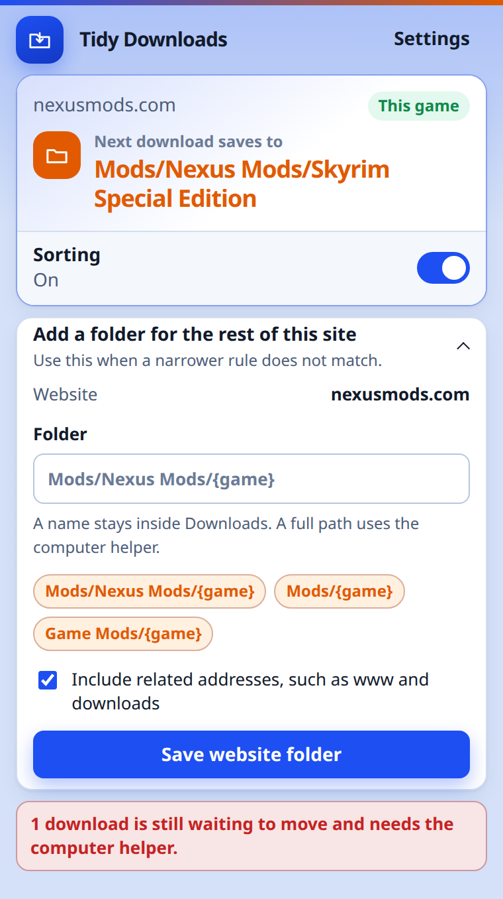
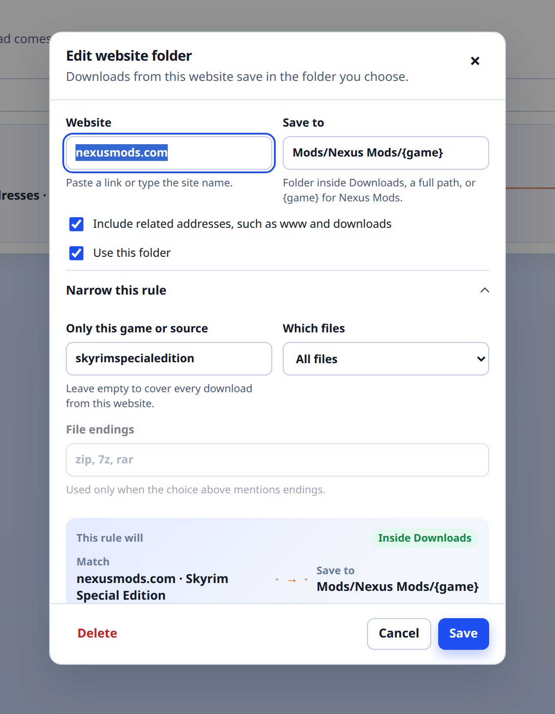
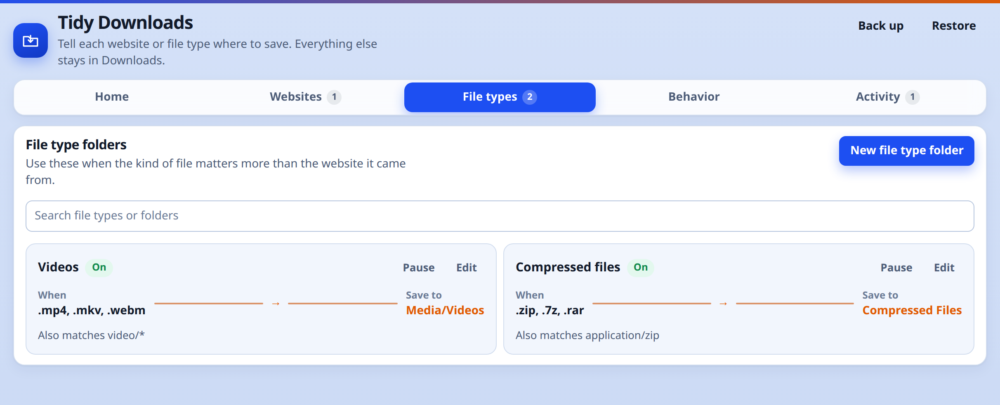
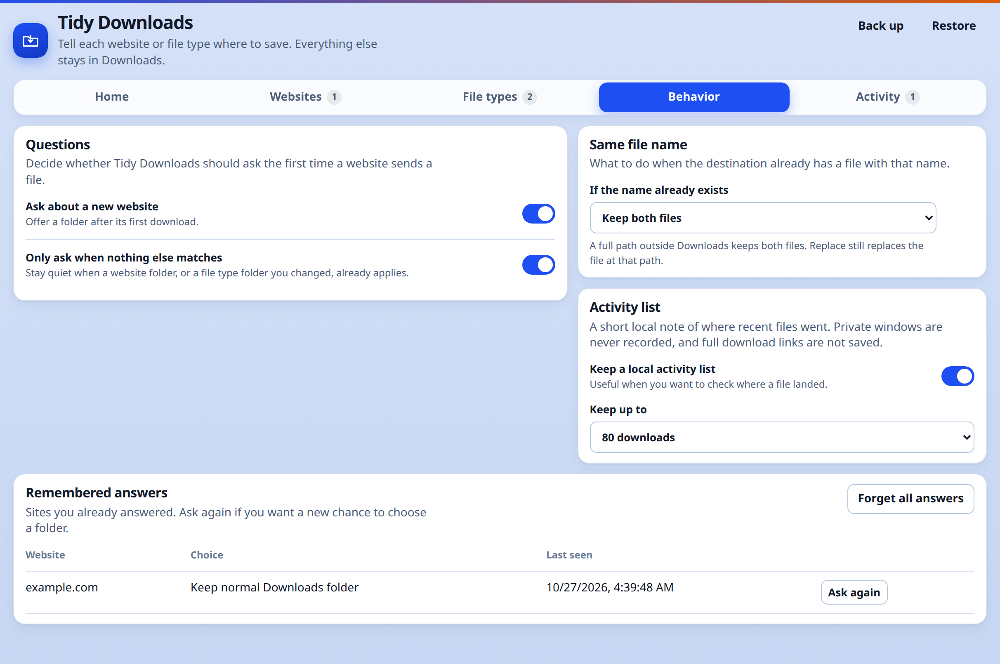
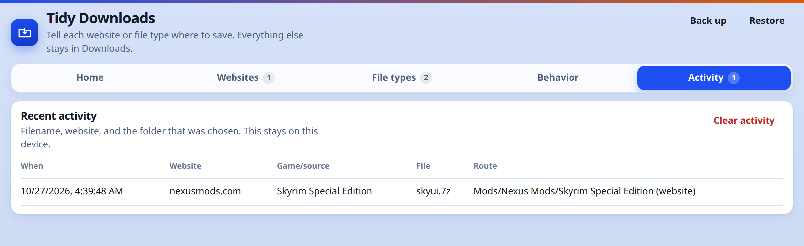

# Tidy Downloads

Tidy Downloads puts Brave downloads into folders by website and by file type.
A mod from Nexus Mods can land in that game's folder. A video can land with your other videos. Everything else stays in Downloads.

It runs only in Brave, and it stays on your computer. It does not send downloads, page addresses, or folder names anywhere.

## Install

1. Download the ZIP from the [latest release](https://github.com/beryllium22/DownloadManagerExtensionTest/releases/latest).
2. Unzip it. You want the folder that contains `manifest.json`, not the ZIP itself.
3. Open `brave://extensions`.
4. Turn on **Developer mode**.
5. Click **Load unpacked**.
6. Pick the unzipped folder.

Brave opens the Tidy Downloads settings page when the extension is first installed.

## First run

Open a site you download from, such as Nexus Mods, and click the Tidy Downloads toolbar button. It shows the folder the next download from that page will use.



If you have not chosen a folder yet, open **Add a folder for the rest of this site**. Pick a suggestion or type a name such as `Mods/Nexus Mods/{game}`, then save it. `{game}` is replaced with the game name when Nexus Mods provides one.



The first download from a new website can also ask you itself. That question is on by default. Turn it off under **Behavior** if you would rather add folders yourself.

A name such as `Mods/Nexus Mods` stays inside Brave's Downloads folder. A full Windows path such as `D:\Games\Skyrim\Mods` needs the helper below.

## Settings

**Websites** is one row per site. Use **Narrow this rule** when only one game, or only some file endings, should use that folder.



**File types** is for the kind of file, no matter which site it came from. Archives and videos are the usual ones.



**Behavior** chooses whether Tidy Downloads asks about a new site, and what happens when the destination already has a file with the same name. **Activity** is a short local note of where recent files went.





File type rules are checked before website rules. You can switch that under Behavior. A narrower website rule, such as one game, wins over a rule for the whole site.

## Optional Windows helper

Brave can only choose a folder inside Downloads. To save on another drive, Tidy Downloads first finishes the file in a `Tidy Downloads Staging` folder, then a small PowerShell helper moves it.

You do not need the helper for folders inside Downloads.

1. On `brave://extensions`, copy the ID under Tidy Downloads.
2. In PowerShell, from the unzipped folder:

```powershell
powershell.exe -ExecutionPolicy Bypass -File .\native-host\install-native-host.ps1 -ExtensionId YOUR_EXTENSION_ID
```

3. Restart Brave.
4. Open Tidy Downloads settings and choose **Check helper**.

The helper is installed for your Windows user. It does not need an administrator. Details are in `native-host/README.md`.

## FAQ

**I loaded it and nothing was added to Brave.**
Unzip the release first, then Load unpacked on the folder that contains `manifest.json`. Loading the ZIP, or a folder that only contains the ZIP, does not install it. Developer mode has to stay on.

**The file stayed in Downloads.**
Open the popup on that site and check the folder. Sorting can be turned off from the popup. A file type rule may have matched first, or no rule matched and asking about new sites is off. Private windows always stay in Downloads.

**It says a download is waiting for the computer helper.**
The folder is a full path, so the file is in `Downloads\Tidy Downloads Staging` until the helper moves it. Install the helper, restart Brave, and use **Check helper**. The file is still on disk. Tidy Downloads does not delete it when the helper is missing.

**Two downloads had the same name.**
The default is **Keep both files**, so Brave adds a number. **Replace the old file** is in Behavior. For a full path outside Downloads, Replace is the only choice that overwrites. The helper will not replace a folder with a file, and it keeps the old file if the new copy cannot be put in place.

**Nexus Mods put the file in the wrong game folder, or in a generic folder.**
The game name comes from the Nexus page address, including the usual download popup. A direct file link with no game in it uses the rest of the folder, not a guessed name. Open the website rule and set **Only this game or source** when one game should have its own folder.

**A folder name was shortened or slightly changed.**
Windows names cannot contain `\ / : * ? " < > |`, end in a dot or space, or use reserved names such as `CON`. Very long names are shortened so the file can still be saved. The popup shows the folder that will actually be used.

**Activity shows a site I did not want remembered.**
Activity is stored only in this browser, and only when **Keep a local activity list** is on. Use **Clear activity** or **Forget all answers**. Private windows are not listed. Full download links are not saved.

**I moved the extension folder and the helper stopped.**
Run the installer again. It copies the helper to `%LOCALAPPDATA%\Tidy Downloads\native-host`, so moving the unzipped folder afterward does not disconnect it. Uninstall with `native-host\uninstall-native-host.ps1`.

## Develop

From a checkout of this repository:

```bash
npm test
npm run preview
npm run package
```

`npm run preview` serves the settings page and popup on `127.0.0.1` with sample data. `npm run package` writes `dist/tidy-downloads-for-brave-1.2.0.zip`. On Windows, `npm run package:windows` builds that same ZIP with PowerShell.
